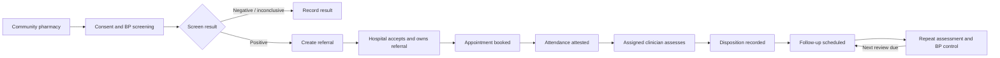
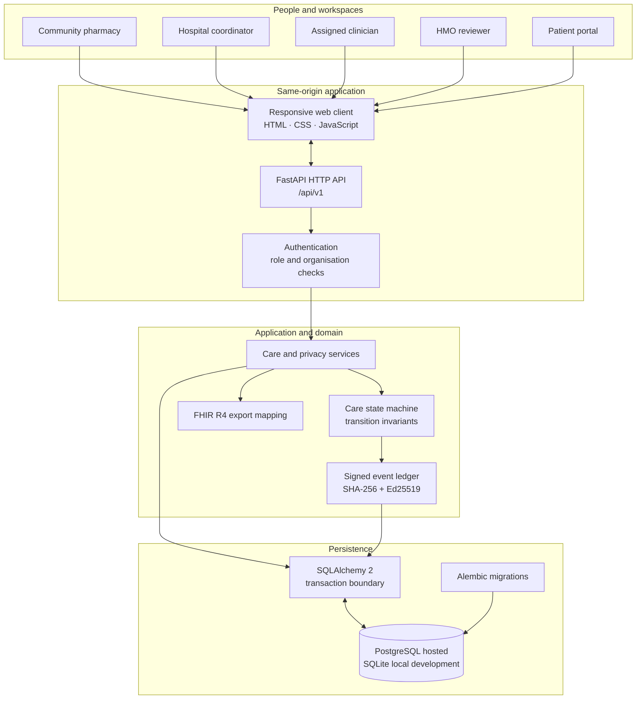

<div align="center">
  
  <h1>OneCare Loop</h1>
  <h3>Close the gap between screening and completed care.</h3>
  <p>A hypertension referral-closure and care-coordination prototype that makes every handoff visible, attributable and verifiable.</p>
  <p>
    <a href="https://onecare-loop-v2.onrender.com/"></a>
    <a href="https://onecare-loop-v2.onrender.com/demo"></a>
    <a href="https://github.com/Vicgrace01/onecare-loop.v2/actions/workflows/ci.yml"></a>
  </p>
  <p>
    
    
    
    
  </p>
</div>

---

## The problem

A blood-pressure screening is only the beginning of a care pathway. A person may be screened at a community pharmacy, referred to a hospital, given an appointment and then become difficult to track. When the handoffs are fragmented, a positive screen can become a referral that nobody clearly owns.

**OneCare Loop is designed to make that journey traceable.** It gives community screening teams, receiving facilities, clinicians and health-plan reviewers role-specific workspaces around one longitudinal referral record and an auditable event history.

> **Product focus:** move from “screened” to “care received, outcome recorded and follow-up planned” — without pretending that a software workflow is a clinical diagnosis.

## Try the prototype

<div align="center">
  <a href="https://onecare-loop-v2.onrender.com/">**Open the live application**</a> &nbsp; · &nbsp;
  <a href="https://onecare-loop-v2.onrender.com/demo">**Run the synthetic end-to-end demo**</a>
</div>

The hosted prototype runs as a FastAPI web service. The `/demo` page creates a synthetic case through the same care services used by the authenticated application, then visualises the persisted result and verifies its signed event chain.

### Demo accounts

The synthetic judge environment provisions four staff workspaces. Unless the corresponding `DEMO_*_EMAIL` variables have been overridden in the host configuration, the login emails are:

| Workspace | Role | Login email | Main responsibility |
|---|---|---|---|
| Community pharmacy | `pharmacy` | `demo.pharmacy@onecareloop.com` | Record a consented screen and start a referral |
| Hospital coordinator | `hospital` | `demo.hospital@onecareloop.com` | Accept, own, route and schedule incoming referrals |
| Assigned clinician | `clinician` | `demo.clinician@onecareloop.com` | Record the confirmatory assessment, disposition and follow-up |
| HMO reviewer | `hmo` | `demo.hmo@onecareloop.com` | Review aggregate referral and closure metrics |

**Passwords are intentionally not stored in this repository.** In the isolated judging deployment, open the [demo page](https://onecare-loop-v2.onrender.com/demo) to view the configured credentials when `DEMO_SHOW_CREDENTIALS=true`. The page obtains them from the runtime configuration endpoint; they are not hard-coded into frontend JavaScript. Use these credentials only for the synthetic challenge environment.

Staff sign in with **email + password** from the homepage. The patient portal is separate and uses a phone-based one-time-code flow; the four staff roles do not sign in with phone numbers.

### What the automatic demo does

1. Creates a synthetic patient and records consent.
2. Records a positive blood-pressure screening at a community pharmacy.
3. Creates a referral with urgency and a service-level deadline.
4. Has the receiving hospital accept the referral and become its accountable owner.
5. Books an appointment and records a simulated patient notification.
6. Attests attendance against the assigned clinician.
7. Records a clinician-entered confirmatory assessment and disposition.
8. Schedules a 30-day follow-up plan.
9. Verifies the patient's ordered, signed event chain.

**Run** creates a new synthetic case. **Replay** reuses the last result and does not create duplicate records. The public demo endpoint is limited to five new runs per client IP per hour.

---

## The care journey

The workflow is more than a referral form. Each transition is performed by an authorised role and recorded as an event.



### Failure paths are recorded too

A facility decline or unavailability, missed appointment, unreachable patient, patient decline, or reschedule request is represented explicitly. Recovery appends new events; it does not silently erase the earlier attempt. Negative and inconclusive screens remain visible records but do not automatically create referrals.

## Product capabilities

| Capability | What the prototype implements |
|---|---|
| Role-based workspaces | Pharmacy, hospital, clinician and HMO views with server-side role checks |
| Screening and referral | Consent capture, blood-pressure inputs, result recording, urgency and referral creation |
| Referral ownership | Hospital acceptance, accountable facility ownership, clinician assignment and reassignment |
| Appointment and attendance | Appointment booking, missed-appointment handling and attendance attestation |
| Clinical disposition | Assigned clinician records a confirmatory assessment or a reason it is not indicated, then records the disposition |
| Follow-up | Follow-up plan, due date, reassessment and BP-control records |
| Exception visibility | Explicit failure events and an idempotent overdue-referral escalation command |
| Patient communications | In-app notification records and referral-scoped consultation messages; external delivery is not connected |
| Operations metrics | Referral counts, closure rate, median time to disposition and failure breakdown |
| Audit integrity | Ordered event history, SHA-256 hash linking, Ed25519 signatures and verification endpoint |
| Interoperability | Authenticated FHIR R4 collection-bundle export for supported resources |

## System architecture

OneCare Loop is a **modular monolith**: one deployable FastAPI application, one relational database and clear internal boundaries. This keeps the prototype deployable and testable without introducing premature microservices.



### Architecture decisions

- **One application boundary:** the web client is served by FastAPI; there is no separate frontend server.
- **Explicit API contracts:** Pydantic validates request and response data; API routes delegate to application services.
- **Server-derived authority:** protected endpoints derive the actor and role from the verified token and reload the active user. Client-supplied actor IDs and roles are not trusted.
- **Organisation isolation:** pharmacy/PMV, hospital and clinician actions are scoped to the relevant organisation, referral and assignment.
- **Atomic care transitions:** state validation, business writes and event append share the request transaction. A failed transition rolls back the related changes.
- **Append-oriented history:** canonical care events determine workflow state. Supplementary events cannot silently advance or rewind the journey.
- **Tamper evidence:** each event commits to its sequence, actor, payload and previous digest; Ed25519 signs the event hash. Verification detects altered or reordered stored events. This is tamper-evident, not tamper-proof against an operator who controls the application, database and signing keys.
- **Explicit migrations:** Alembic owns database schema changes. Production schema creation is disabled; migrations are applied as a deployment step.

## Technology

| Layer | Technology |
|---|---|
| Runtime | Python 3.11+; CI matrix covers Python 3.11 and 3.12 |
| Web/API | FastAPI, Uvicorn |
| Contracts/configuration | Pydantic 2, pydantic-settings |
| Persistence | SQLAlchemy 2, SQLite for local work, PostgreSQL for hosted deployment |
| Schema evolution | Alembic |
| Password security | Argon2 password hashing |
| Event integrity | SHA-256 digests and Ed25519 signatures |
| Data protection | Cryptography-based encryption with patient-scoped data keys and a separate PII key |
| Browser tests | Playwright with Chromium |
| CI | GitHub Actions |
| Hosting | Render web service; database URL supplied by the hosting environment |

## Repository map

```text
.
├── app/
│   ├── api/v1/          # Versioned HTTP routes and dependencies
│   ├── core/            # Runtime settings and security primitives
│   ├── db/              # SQLAlchemy models, engine and sessions
│   ├── domain/          # Workflow states, ledger hashing and verification
│   ├── schemas/         # Pydantic request/response contracts
│   ├── services/        # Auth, care, privacy and FHIR use cases
│   └── web/             # FastAPI-served interface and static assets
├── migrations/          # Alembic environment and schema revisions
├── tests/               # Unit, API, workflow, integrity and browser tests
├── docs/                # Architecture, workflow, operator and security guides
├── deploy/              # Judge-demo template and deployment checklist
├── .github/workflows/   # CI pipeline
├── Dockerfile
├── compose.yaml
├── pyproject.toml
└── README.md
```

## API overview

All application API routes use the `/api/v1` prefix.

| Area | Representative routes |
|---|---|
| Health | `GET /health/live`, `GET /health/ready` |
| Authentication | `POST /auth/login`, `POST /auth/register`, `GET /auth/me`, `POST /auth/provision` |
| Screening | `POST /screenings` |
| Referrals | `POST /referrals`, `GET /referrals/{id}/history` |
| Hospital operations | `GET /hospital/queue`, `POST /hospital/referrals/{id}/accept`, `/assign`, `/appointments`, `/attendance`, `/disposition` |
| Patient access | OTP request/verification, protected receipt and acknowledgement endpoints |
| Follow-up | Patient follow-up plans, reassessment and BP-control endpoints |
| Communications | Red-flag acknowledgement, referral messages and notification records |
| Metrics | `GET /metrics` — admin/HMO access |
| Audit | Patient event retrieval and hash/signature verification |
| FHIR | `GET /fhir/metadata`, `GET /fhir/patients/{id}/bundle` |
| Judge demo | `GET /demo/info`, `POST /demo/run` |

The interactive OpenAPI documentation is available at `/docs` in local development. It is disabled in the production runtime configuration.

## Run locally

### Requirements

- Python 3.11 or 3.12 recommended.
- Git.
- Chromium installed through Playwright for browser tests.

### Windows PowerShell

```powershell
# Clone the repository
git clone https://github.com/Vicgrace01/onecare-loop.v2.git
Set-Location .\onecare-loop.v2

# Create and activate a virtual environment
py -3.11 -m venv .venv
.\.venv\Scripts\Activate.ps1

# Install the application and development dependencies
python -m pip install --upgrade pip
python -m pip install -e ".[dev]"

# Prepare local configuration
Copy-Item .env.example .env
```

Edit `.env` and set three distinct random values for `SECRET_KEY`, `SIGNING_MASTER_KEY` and `PII_ENCRYPTION_KEY`. Keep `.env` private and out of Git. For ordinary development, leave public judge-demo switches disabled. The local example configuration uses SQLite.

Apply the database migrations and start the application:

```powershell
alembic upgrade head
uvicorn app.main:app --reload
```

Open `http://127.0.0.1:8000`.

### Verify locally

```powershell
# Install the browser used by the end-to-end tests
python -m playwright install chromium

# Run the complete test suite
python -m pytest -q

# Check the current database connection through the readiness endpoint
Invoke-RestMethod http://127.0.0.1:8000/api/v1/health/ready
```

The latest recorded local validation for the release environment was **46 tests passed** on Python 3.11. The GitHub Actions workflow validates the Python 3.11 and 3.12 matrix, runs Chromium browser tests, performs an Alembic upgrade/downgrade/upgrade smoke test and builds the Docker image. See the live [Actions history](https://github.com/Vicgrace01/onecare-loop.v2/actions) for the status of the current commit.

## Deployment

The public prototype is hosted at [onecare-loop-v2.onrender.com](https://onecare-loop-v2.onrender.com/). The hosted application uses a PostgreSQL `DATABASE_URL`; local development defaults to SQLite.

Important deployment settings:

```dotenv
APP_ENV=production
AUTO_CREATE_SCHEMA=false
SEED_DEMO_ADMIN=false
```

The hosted environment must also provide three different secrets: `SECRET_KEY`, `SIGNING_MASTER_KEY` and `PII_ENCRYPTION_KEY`. Do not commit them, include them in screenshots, or paste them into issue reports. The PII key must be separate from the signing key. Apply Alembic migrations before serving traffic. See [`deploy/production-checklist.md`](deploy/production-checklist.md).

The demo accounts are provisioned at application startup only when `DEMO_MODE_ENABLED=true`. They are designed for an isolated synthetic-data judging environment, not a database containing real patient records. `DEMO_SHOW_CREDENTIALS=true` displays the configured passwords on the public demo page; only use unique, disposable passwords in that environment.

## What is intentionally not connected

The prototype is explicit about the boundary between implemented workflow logic and services that would require clinical approval, provider agreements or production integration.

| Area | Current state |
|---|---|
| NHIA / DHIN eligibility | No live query. Eligibility is recorded as `unknown`. |
| SMS / WhatsApp / voice | Notification records are simulated; no external message is sent. |
| Emergency response | Red-flag events and acknowledgements can be recorded; no ambulance or emergency coordinator is dispatched. |
| Follow-up reminders | Plans and due dates are stored; no background reminder worker is running. |
| SLA escalation | An idempotent CLI command can create overdue-referral exception records when invoked by an external scheduler; it does not page a person or change clinical state automatically. |
| Financial savings | No payer value or recovered-savings estimate is fabricated. |
| FHIR | Authenticated FHIR R4 collection-bundle export is implemented; this is not a complete FHIR server. |
| Clinical decision-making | Screening and assessment records support coordination; the system does not diagnose, prescribe or replace clinician judgement. |

## Safety, privacy and governance

- Patient contact details, measurements, notes and other protected patient fields are encrypted using patient-scoped data keys.
- Account email addresses are encrypted separately and indexed using keyed lookup material.
- Staff actions are authenticated and restricted by role, organisation and referral assignment.
- Consent withdrawal destroys the wrapped patient data key and disables the patient account; the event chain remains verifiable while protected historical content becomes unavailable to the application.
- The event ledger is tamper-evident, not a substitute for independent external anchoring or a complete key-management service.
- This prototype has not been independently approved for clinical use, regulatory compliance or real-patient deployment.

**Do not enter real patient information into the public prototype.** Before any real-world pilot, the project requires clinical protocol approval, privacy impact and legal review, retention and incident-response policies, managed key storage and rotation, rate limiting, security testing, backup/restore validation, vendor and residency review, and signed agreements for external integrations.

## Documentation

- [Architecture and trust boundaries](docs/architecture.md)
- [Care workflow and state transitions](docs/care-workflow.md)
- [Competition demo guide](docs/competition-demo-guide.md)
- [Operator guide](docs/operator-guide.md)
- [Security review and remaining risks](docs/security-review.md)
- [Production deployment checklist](deploy/production-checklist.md)
- [Release notes](RELEASE_NOTES.md)

## Status and roadmap

This is a deployed, test-validated prototype. The next engineering work should focus on improving the judging experience and validating the workflow with relevant clinical and operational stakeholders, then addressing production gaps before any real-world pilot.

Near-term priorities:

1. Capture real screenshots of the pharmacy, hospital, clinician, HMO and automatic-demo screens for the project documentation.
2. Improve the end-to-end judging walkthrough and make the role-specific actions easier to discover.
3. Validate referral exception handling, metrics definitions and patient-facing language with qualified reviewers.
4. Complete the security, privacy, clinical and operational work listed in the production checklist.

## License

MIT. Review ownership, dependencies and third-party notices before redistribution.

---

<div align="center">
  <strong>OneCare Loop</strong><br />
  <sub>Make every referral visible. Make every handoff accountable. Make follow-up part of the journey.</sub>
</div>
